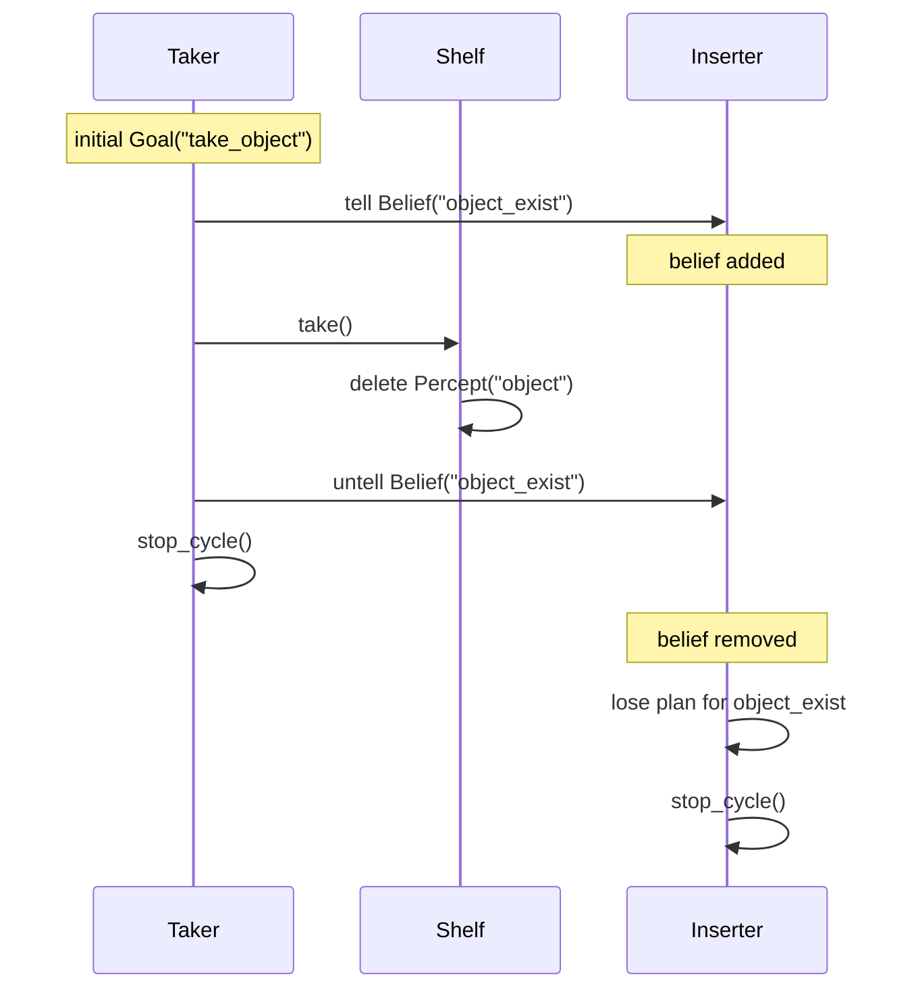

# maspy-shelf-robot-manager

Shelf robot manager implementation using [MASPY](https://github.com/laca-is/MASPY).

## Run

```bash
make setup
make run
```

To run against the MASPY `integration` branch:

`integration` is the integration branch of the `geovanaSouza/MASPY` fork. It bundles behavior fixes that are not yet available in the published PyPI release — issues [#24](https://github.com/laca-is/MASPY/issues/24), [#25](https://github.com/laca-is/MASPY/issues/25), and [#26](https://github.com/laca-is/MASPY/issues/26).

```bash
make install-integration
make run
```

Use `make install-maspy MASPY="git+https://github.com/geovanaSouza/MASPY.git@<ref>"` to install another MASPY ref.

`make help` lists all available commands.

## Actors

| Actor | Kind | Starts with | Responsibility |
| --- | --- | --- | --- |
| `Shelf` | Environment | `Percept("object")` | Holds the object and exposes the `take` action. Taking the object removes the percept. |
| `Taker` | Agent | `Goal("take_object")` | Takes the object and announces its availability before taking and its removal afterwards. |
| `Inserter` | Agent | — | Detects that the object is gone and signals that a replacement is needed. |

## Flow



## Known issue and workaround

In MASPY `2026.5.13`, removing a percept from the environment should surface to the agent as a belief removal. In practice, the agent receives a `lose` event carrying a `Percept`, while plans are declared with `Belief` triggers. The trigger lookup does not normalize `Percept` to `Belief`, so a lose plan declared for `Belief("object")` does not fire when the shelf deletes `Percept("object")`. This is a regression in `2026.5.13`; the equivalent flow works on `2025.11.9`.

The underlying bug is tracked in [MASPY issue #26](https://github.com/laca-is/MASPY/issues/26).

To keep the example working, the Taker mirrors the object as the regular belief `object_exist`:

- before taking: `tell(Belief("object_exist"))`;
- after taking: `untell(Belief("object_exist"))`.

The Inserter listens for the removal of `object_exist`, not for the environment percept. Because this is a `Belief` loss, the current trigger lookup matches it and the plan runs.

The Inserter is created with `instant_mail=True` so the `untell` is handled immediately by the messaging thread. Without it, the current MASPY version deadlocks while processing `untell` inside the reasoning cycle.

Once issue #26 is fixed, the workaround can be removed.

## Project structure

```text
src/shelf/
├── __init__.py          # package exports
├── __main__.py          # entry point (python -m shelf)
├── environment.py       # Shelf: owns the object percept and the take action
├── simulation.py        # creates the actors, connects them, and starts MASPY
└── agents/
    ├── __init__.py
    ├── inserter.py      # reacts when the object is no longer available
    └── taker.py         # takes the object and announces its removal
```
